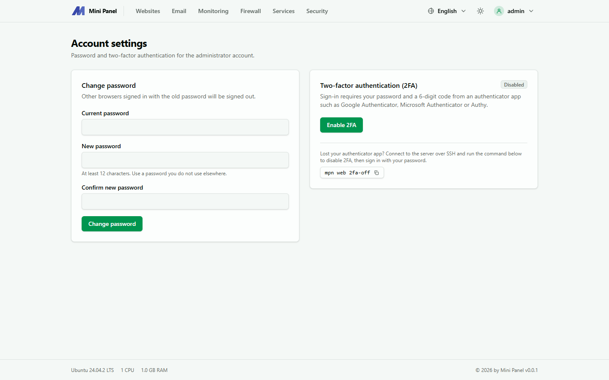

# Account settings

Open the **Account** menu at the top and choose **Settings**. This page manages the admin account’s password and two-factor authentication.

## Changing the password

Enter the **Current password**, then the **New password** twice and click **Change password**. The new password must differ from the current one and be between the minimum length shown on the page and 256 characters. After the change, other browsers signed in with the old password are signed out.

## Two-factor authentication (2FA)

Besides the password, signing in also needs a 6-digit code from an authenticator app on your phone, such as Google Authenticator, Microsoft Authenticator or Authy.

### Turning on 2FA

1. Click **Enable 2FA**.
2. Scan the QR code with the authenticator app, or enter the **Manual key** into the app.
3. Enter the 6-digit code now shown and click **Confirm and enable**.

The next time you sign in, enter your password followed by the six-digit code. After too many wrong attempts you must sign in again from the start.

### Turning off 2FA

This needs both the password and the current code, so someone who gets hold of your session still cannot turn it off.

### Recovering access without your authenticator

Sign in to the server over SSH and run the command shown on the Settings page to turn 2FA off, then sign in with the password only.

## Updating the panel

Updating has its own page: click **Update** in the main menu. It shows the running version. Click **Check for updates**; when a new release is out, click **Update**. See [Installation › Updating](getting-started/installation.md#updating) for how the panel checks the signature and goes back to the old program.
