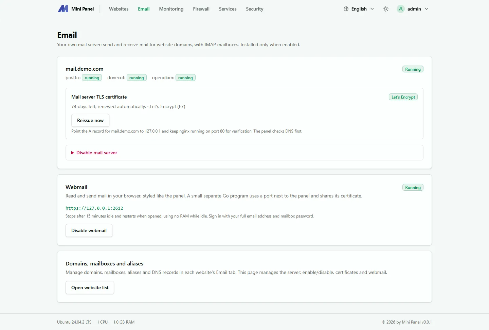

# Email

The **Email** page manages the server-wide mail server: it receives and sends mail for your websites’ domains, and mailboxes are read over IMAP. The mail server is installed only when you turn it on.

## Turning on the mail server

When enabled, the panel installs Postfix (receive and send), Dovecot (mailboxes, IMAP) and OpenDKIM (signing). These three services use about 40 to 80 MB of RAM. Turning it off stops the services and keeps mailboxes and DKIM keys.

1. Enter the **Mail server name**, for example `mail.example.com`.
2. Point its **A** record to the server IP, and set the IP’s **PTR** (reverse DNS) to the same name at your hosting provider.
3. Click **Enable mail server**.

The panel opens the mail ports in the firewall if the panel firewall is on. Many VPS providers block outbound port 25. Ask them to open it if mail does not go out.

If Exim, Sendmail or OpenSMTPD holds port 25 on the machine, remove it first.

## TLS certificate

The initial certificate is self-signed, so mail apps will warn. Click **Get Let’s Encrypt certificate** for the mail server name before real use. It needs the A record to be correct and Nginx running on port 80. The panel renews it automatically.

## Mail domains

Add a domain in **Mail domains**. The panel creates a DKIM key and shows the DNS records to add (MX, SPF, DKIM, DMARC). DMARC starts in monitoring mode (`p=none`).

If the domain uses Cloudflare, see [Adding DNS through Cloudflare](dns-cloudflare.md).

## Mailboxes and aliases

You can also manage mailboxes and aliases in each website’s **Email** tab.

* **Mailboxes**: name, a 10 to 128 character password (the panel stores only a hash), and an optional maximum size.
* **Aliases**: mail sent to an alias is forwarded to up to 20 target addresses, including ones on other domains.
* Deleting a domain removes all its mailboxes and aliases from the panel. Tick the extra box to also delete the stored mail on disk.

## Mail client settings

* **Incoming (IMAP)**: your mail server name, port 993 (SSL/TLS).
* **Outgoing (SMTP)**: port 465 (SSL/TLS) or 587 (STARTTLS).
* The username is the full email address.

Next: [Webmail](webmail.md).
