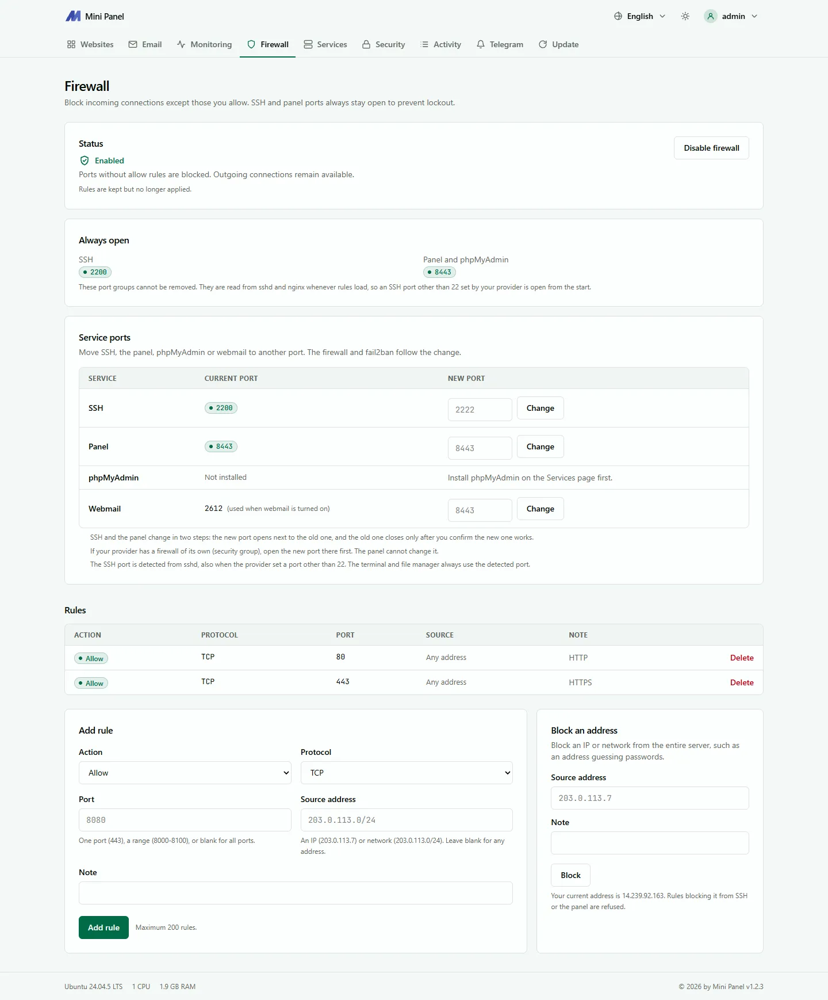

# Firewall



The **Firewall** page blocks every connection to the server except what you allow. The panel uses nftables.

## Always open

The **SSH** port and the **panel** port (with phpMyAdmin) are always open and cannot be deleted, so you cannot lock yourself out. They are read from sshd and nginx every time rules are loaded, so an SSH port other than 22 that your provider set is open from the start.

## Service ports

The **Service ports** card moves SSH, the panel, phpMyAdmin or webmail to another port. Enter the new port next to the service and click **Change**. The firewall rules and the fail2ban jails follow the change.

SSH and the panel change in two steps, so a wrong port never locks you out:

1. The new port opens next to the old one. Both work.
2. Check the new port. For SSH, open a new SSH session on it; sessions that are open stay open. For the panel, click **Open the panel on port …**.
3. Close the old port: **It works, close …** for SSH, **Close port …** on the panel page opened on the new port. **Cancel, keep the old port** goes back.

If nothing is done for 10 minutes, the old port alone is restored.

phpMyAdmin and webmail change in one step. Moving the panel keeps their ports. A webmail port set while webmail is off is used when it is turned on. Through the panel’s domain (`/pma/`, `/webmail/`) the port does not matter.

| Service | Allowed ports |
| --- | --- |
| SSH | 1 to 65535 |
| Panel, phpMyAdmin, webmail | 1024 to 65535 |

Ports used by websites (80, 443), mail, MySQL, PHP-FPM, another service, a Node.js or Python site, or any other program are refused.

Caution

If your provider has a firewall of its own (security group, cloud firewall), open the new port there before you change it. The panel cannot change that firewall.

The same works from SSH, useful if the panel cannot be reached:

```
mpn port status

mpn port set -service ssh -port 2222 -apply

mpn port finish -service ssh -apply     # or: mpn port cancel -service ssh -apply
```

The SSH port is changed in `/etc/ssh/sshd_config.d/00-mpn-port.conf`. `Port` lines in other files are commented out, and the original files are kept in `/var/backups/mpn-ssh-port`. If `sshd -t` rejects the result, every file is put back. A configuration whose `ListenAddress` names its own port is not changed; change that one by hand.

## Turning it on

Click **Enable firewall**. The first time, the panel installs nftables if missing and opens ports 80 and 443 (websites) plus the SSH and panel ports. The server can still reach the Internet normally.

**Disable firewall** keeps the rules and only stops applying them. If the machine runs ufw, turn it off first: two firewalls together make the rules unpredictable. On AlmaLinux, Rocky Linux and CentOS Stream the installer has already turned firewalld off.

## Adding a rule

| Field | Meaning |
| --- | --- |
| **Action** | Allow or Block |
| **Protocol** | TCP, UDP or both |
| **Port** | A port (`443`), a range (`8000-8100`), or blank for all ports |
| **From address** | One IP (`203.0.113.7`) or a network (`203.0.113.0/24`); blank for all addresses |
| **Note** | Optional |

There is a maximum number of rules, shown next to the add button.

## Block an address

The **Block an address** section blocks an IP or a network from the entire server, for example an address guessing passwords.

Note

The page shows your current IP address. A rule that would block this address from SSH or the panel is rejected.
