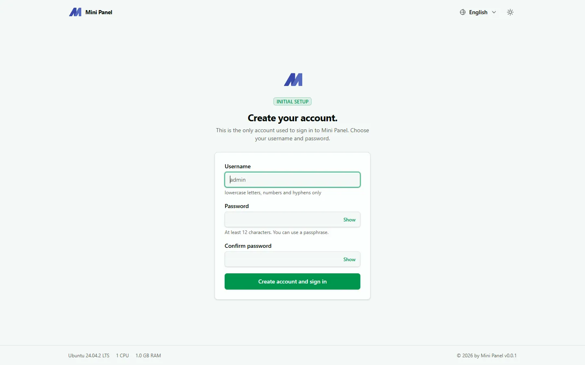

# First-run setup

After [installing](installation.md), open the **setup link** the installer printed, in the form `https://<vps-ip>:2610/setup?t=…`. The link carries a one-time key. Opened without the key, `/setup` says it is locked, so someone who knows the panel address cannot create the account.

If you lost the link, sign in to the server over SSH and run the command below to print it again. The SSH login message also shows it until the account exists.

```
mpn web setup-link
```



## Creating the account

Fill in the form:

* **Username**: lowercase letters, numbers and hyphens/underscores only, starting with a letter.
* **Password**: at least 12 characters. A passphrase works well, e.g. `purple-horse-jumps-the-fence`.
* **Confirm password**: must match the password above.

Click **Create account and sign in**. The panel saves the account to `/var/lib/mpn-web/account.json` (managed directly by the panel without the root helper) and takes you straight to the main page.

Only one account

MCPN supports one administrator account and has no per-user roles. Protect the account with [two-factor authentication](../account-settings.md).

## After creating the account

* The setup key is deleted and `/setup` no longer opens; from now on you sign in through the regular [login page](signing-in.md).
* You should enable [two-factor authentication (2FA)](../account-settings.md) right away, especially if the panel is exposed on a public IP without firewall restrictions on who can reach it.
