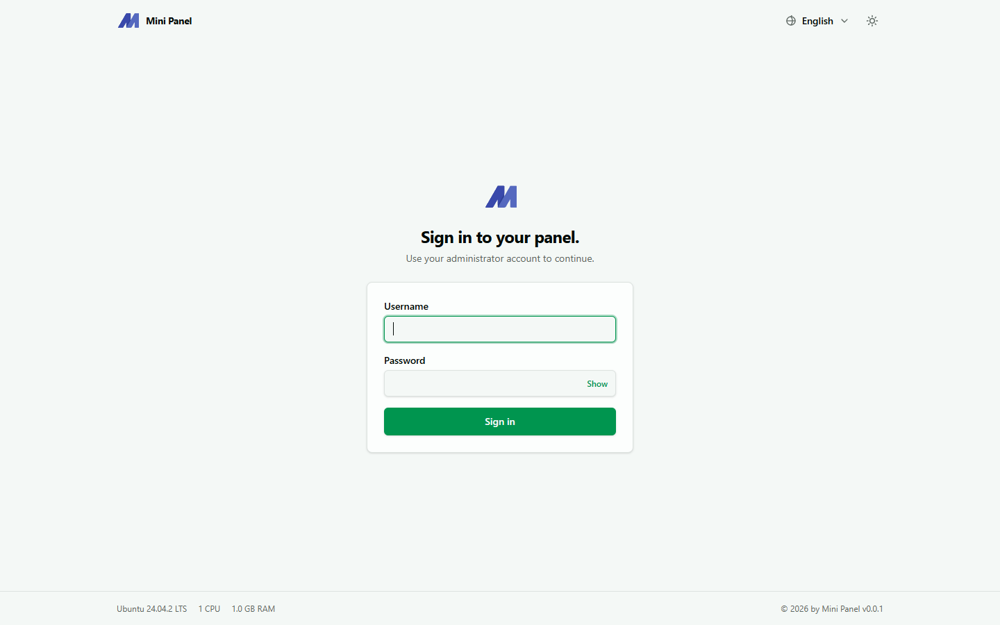

# Signing in

Once you have an [account](first-run-setup.md), open `https://<vps-ip>:2610/login`.



## Regular sign-in

Enter your username and password, then click **Sign in**.

After too many failed attempts, the panel temporarily blocks sign-in attempts from your IP address for a few dozen seconds — a built-in guard against password guessing, with no need for a separate fail2ban jail on the login page itself (fail2ban is still used on the [Security page](../security.md) for SSH).

## Signing in with two-factor authentication (2FA)

If you’ve enabled 2FA in [Account settings](../account-settings.md), after entering the correct password the panel shows an extra step asking for the 6-digit code from your authenticator app (Google Authenticator, Authy…).

This step has a time limit: wait too long or enter the wrong code too many times, and the sign-in session expires — you’ll have to enter your password again from the start.

## Forgot password

MCPN has no “forgot password” email flow, since the panel doesn’t require a mail server. To reset your password if you’re locked out, SSH into the VPS as root and run:

```
mpn web passwd
```

This prompts for a username and new password directly in the terminal, overwriting the existing account.
