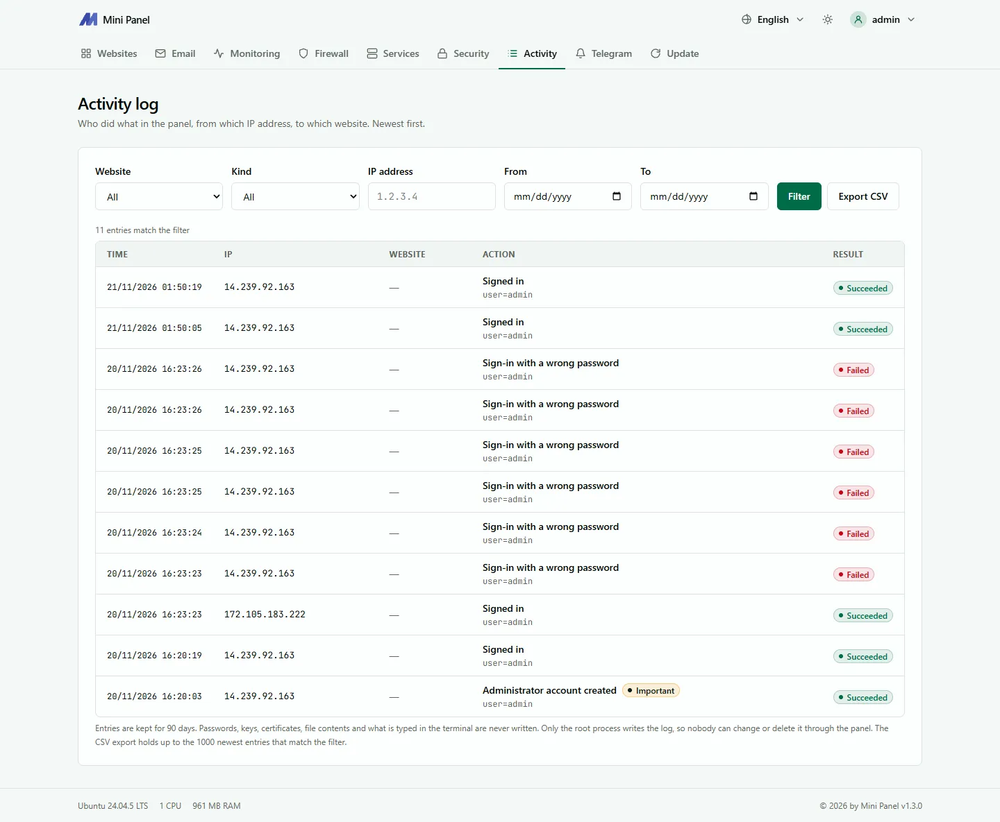

# Activity log

The **Activity** page records what was done through the panel: sign-ins, websites created or removed, files changed, databases, SSL, backups, firewall and security changes. Each entry shows the time, the IP address, the website and whether it succeeded. Newest entries come first.

Each website also has an **Activity** tab with only the entries for that website.

## Filters

* **Website**, **Kind** and **IP address** narrow the list.
* **From** and **To** pick a date range.
* **Export CSV** downloads up to the 1000 newest entries that match the filter.

Entries marked **Important** are changes that are hard to undo, such as deleting a website or a database, changing a password, turning the firewall off, or removing a service. With [Telegram alerts](telegram-alerts.md) on, these are also sent to Telegram.

## What is recorded

* Entries are kept for **90 days**.
* Passwords, keys, certificates, file contents and what is typed in the terminal are **never** written. The terminal records only that a session was opened.
* Only the root process of the panel writes the log, so nobody can change or delete entries through the panel.
* Work the panel does on its own, such as the nightly backup, shows **system** as the IP address.
