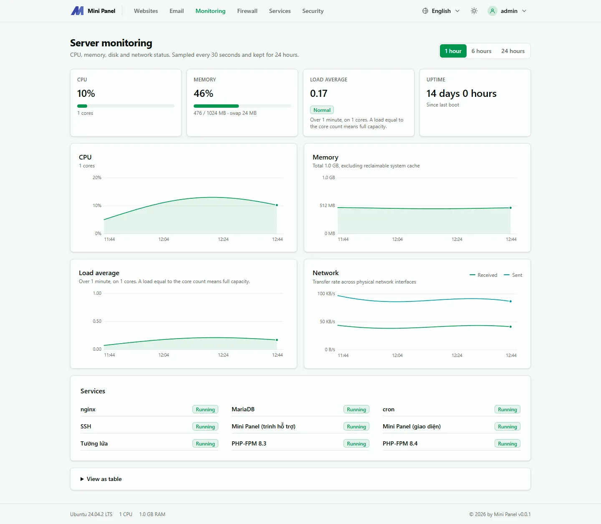

# Monitoring

The **Monitoring** page shows the state of the processor, memory, disks and network. Figures are sampled every 30 seconds and kept for 24 hours. A freshly installed panel needs a few minutes to collect two samples before charts appear.

## Time range

Choose **1 hour**, **6 hours** or **24 hours** to change the range of the charts. Each chart can also be viewed as a table.

## Metrics

* **Processor**: CPU usage and core count.
* **Memory**: used memory, excluding reclaimable system cache, plus swap.
* **Load average**: 1-minute load compared with the core count. A load equal to the core count is full. Labels: Normal, Fairly high, Overloaded.
* **Uptime**: since the last boot.
* **Disk**: usage per partition. The **Filling up** and **Almost full** labels warn early.
* **Network**: receive and send speed across physical network interfaces.
* **Services**: Running, Stopped or Failed. Manage them in [Services](../services.md).
