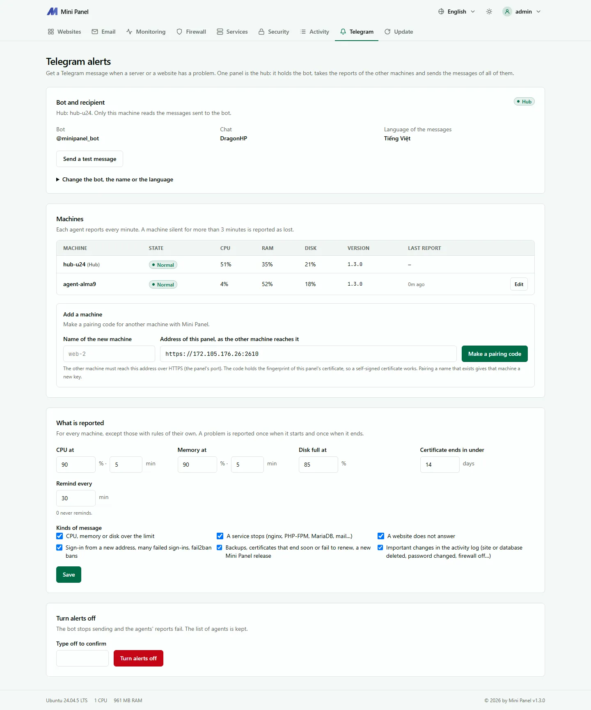

# Telegram alerts

MCPN can send a Telegram message when something goes wrong: a service stops, a website does not answer, the disk fills up, or someone signs in from a new address. One panel is the **hub**. It holds the bot, collects the reports of your other servers (the **agents**) and sends the messages for all of them to one chat.

The alerts run in their own service, `mpn-notify`, so they keep working while the panel restarts or updates.

## Set up the hub

1. In Telegram, send `/newbot` to [@BotFather](https://t.me/BotFather) and follow its steps. It gives you a token.
2. Open **Telegram** in the panel menu. Under **This machine is the hub**, paste the token, give the machine a name and pick the language of the messages.
3. Send `/start` to your bot. For a group, add the bot to the group and send `/start` there.
4. Reload the page, choose the chat and click **Send the alerts to this chat**. A test message arrives.

With only one server, this is all you need.

## Add more servers

1. On the hub, under **Add a machine**, type a name for the new server and the address of the hub’s panel as the other server reaches it (for example `https://203.0.113.10:2610`). Click **Make a pairing code**.
2. Copy the code. It is shown only once, works once and ends after 1 hour.
3. On the other server, open **Telegram**, paste the code under **This machine reports to a hub** and click **Connect**.

The agent reports every minute. The code holds the fingerprint of the hub’s certificate, so a self-signed certificate works and no other server can pretend to be the hub. The other server must reach the hub’s panel port over HTTPS.

The hub’s page lists every machine with its CPU, memory, disk, version and last report. **Remove the machine** revokes its key.

## What is reported

| Kind | When |
| --- | --- |
| Resources | CPU or memory over the limit for several minutes in a row (default 90% for 5 minutes), disk over the limit (default 90%) |
| Services | nginx, PHP-FPM, the database, mail or fail2ban stops |
| Websites | a website does not answer through nginx, checked every 2 minutes |
| Security | a sign-in from a new IP address, many failed sign-ins, fail2ban bans an address |
| Operations | a backup fails or succeeds, a certificate ends soon or fails to renew, a new MCPN release |
| Important changes | the entries marked Important in the [activity log](activity-log.md) |

A problem must be seen on two checks in a row before it is sent, so a short blip is not reported. You get one message when it starts, a reminder every 30 minutes while it lasts, and one message when it ends.

The limits and kinds are set once on the hub under **What is reported**. Each machine can have rules of its own: click **Edit** next to it.

## When a machine goes silent

* An agent that has not reported for **3 minutes** is reported as lost, and again when it comes back.
* When the hub itself is down, each agent notices after 3 minutes and sends its alerts to Telegram directly, with the bot the hub shared. When the hub answers again, the agent says so once.

## Bot commands

Send `/status` to the bot in the chosen chat for a summary of every machine. The bot answers only that chat.

## Turning alerts off

Under **Turn alerts off**, type `off` and confirm. On the hub, the bot stops sending and the agents’ reports fail; the list of agents is kept. On an agent, it stops reporting; remove it on the hub.

The token is stored only in `/etc/mpn/notify.json`, readable by root. Agents keep a copy for sending directly when the hub is down.
