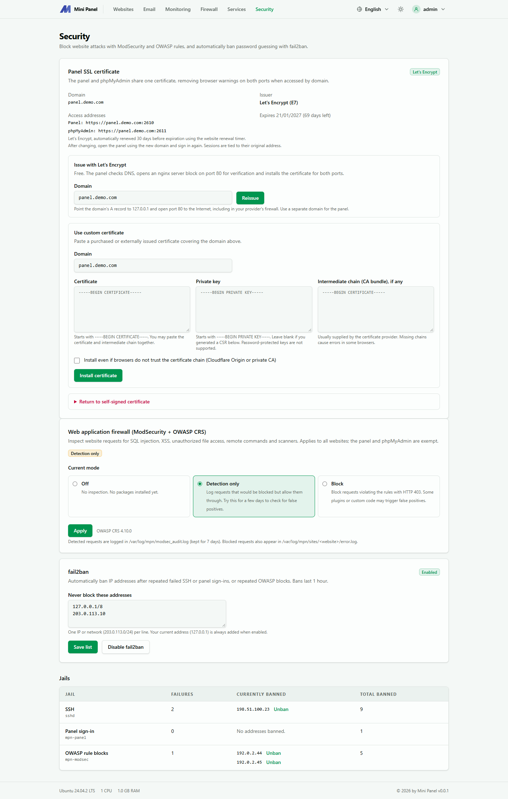

# Security

The **Security** page has three parts: the SSL certificate of the panel itself, blocking attacks on websites (ModSecurity with the OWASP rules) and automatically banning addresses that guess passwords (fail2ban).

## Panel SSL certificate

The first card shows which certificate the panel uses. A new install uses a **self-signed** certificate, so browsers warn that the connection is not secure when you open the panel by IP address. Issue a certificate for a domain to remove the warning.

The panel (port 2610) and phpMyAdmin (port 2611) share one certificate, so issuing it once removes the warning on both ports.

| Source | Meaning |
| --- | --- |
| **Self-signed** | The default. Browsers warn; use it only until you have a domain |
| **Let’s Encrypt** | Free, renewed automatically 30 days before expiry (with the same timer as website certificates) |
| **Custom certificate** | A certificate you bought or got elsewhere. It does not renew automatically |

Once a certificate is installed, the card shows the domain, the source and the access addresses. A warning appears if the certificate **does not cover** the domain in use.

### Issue with Let’s Encrypt

1. Pick a separate domain for the panel, for example `panel.example.com`. Do not use the name of a website, the panel refuses it.
2. Point the domain’s **A** record to the server’s IP address. The card shows the IP to use.
3. Open port 80 to the Internet, including in your VPS provider’s firewall.
4. Enter the domain and click **Issue certificate**.

The panel checks DNS first. If the domain does not point to the server yet, it reports the problem instead of sending a request that would be rejected. For verification, the panel opens an Nginx server block on port 80 for the panel’s domain only. It answers the Let’s Encrypt challenge and sends other requests to the panel’s port. This panel workflow issues certificates for domain names only.

### Paste a custom certificate

Enter the domain, then the **Certificate**, **Private key** and optional **Intermediate chain** fields, the same as on a [website’s SSL tab](websites/ssl.md). The certificate must cover the domain above. For a Cloudflare origin certificate or a private CA, tick the option to install even though browsers do not trust the chain.

Caution

A custom certificate does not renew automatically. Paste a new one before it expires.

### Access addresses

Once a certificate matches the domain, the card lists the addresses that work:

* Panel: `https://domain:2610`, phpMyAdmin: `https://domain:2611`.
* With a Let’s Encrypt or custom certificate that matches the name, Nginx also serves the domain on port 443: the panel at `https://domain` and phpMyAdmin at `https://domain/pma/`. Opening the panel by IP still uses the two ports above.

Note

A sign-in session is tied to the address it was created on. After changing the certificate, open the panel using the new domain and sign in again.

### Return to self-signed

Open **Return to self-signed certificate** and click **Use self-signed certificate**. The panel stops responding on that domain and is reachable only by IP address with the self-signed certificate.

## Web application firewall

It inspects every request sent to a website to block SQL injection, XSS, unauthorized file reads, remote command execution and scanners. It applies to every website. The panel and phpMyAdmin are exempt.

| Mode | Meaning |
| --- | --- |
| **Off** | No inspection, no package installed |
| **Detect only** | Logs requests the rules would block, but lets them through |
| **Block** | Blocks violating requests and returns 403 |

Tip

Run **Detect only** for a few days before switching to **Block**, to see whether any plugin or custom code gets blocked by mistake.

The first time, the panel installs `libnginx-mod-http-modsecurity` and `modsecurity-crs`. The rule set uses about 30 to 60 MB of RAM. Caught requests go to `/var/log/mpn/modsec_audit.log` (kept 7 days). Requests actually blocked are also written to `/var/log/mpn/sites/<website>/error.log`.

## Visitor addresses behind Cloudflare

When websites are proxied by Cloudflare, Nginx sees only Cloudflare’s addresses. Turn on the **Visitor addresses behind Cloudflare** card so logs, fail2ban and the firewall see the visitor’s real address. From a terminal: `mpn security cloudflare -on -apply`.

Nginx takes the address from the `CF-Connecting-IP` header only on connections that come from Cloudflare’s published networks; the header sent by anybody else is ignored. Off by default.

## fail2ban

It bans an IP address after repeated wrong SSH or panel logins, and after many requests blocked by the OWASP rules. A ban lasts 1 hour.

* **Addresses never blocked**: one IP or network per line. Your current IP is always added when you turn it on.
* **Jails**: SSH, Panel login, Blocked by OWASP rules. The table shows failures, currently banned addresses and total banned.
* **Unban**: lifts the ban on an address immediately.
