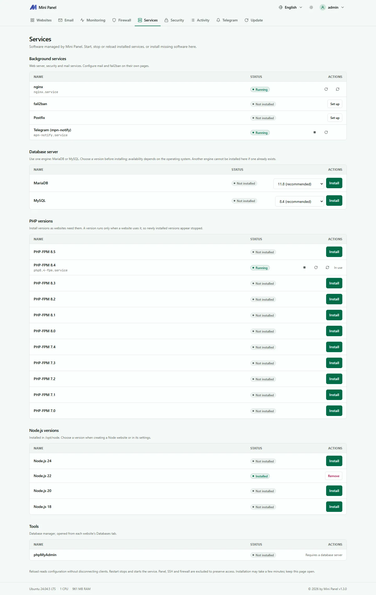

# Services

The **Services** page lists what MCPN manages on the server. Installed components can be started, stopped or reloaded right here. Components that are not installed can be installed with one button.

## Service groups

* **Background services**: the web server, security and mail server programs. The mail suite and fail2ban are installed from their own pages.
* **Database servers**: choose MariaDB or MySQL as the MySQL-family server; those two cannot be installed together. PostgreSQL can be installed alongside it. Pick a version before installing. Available versions depend on the operating system; MCPN currently offers PostgreSQL 16, 17, 18 and 19, with 18 recommended. When you add a database to a website, choose one of the engines installed on the machine.
* **PHP versions**: install more when a website needs them. A version runs only when a website uses it, so a freshly installed version shows as stopped.
* **Tools**: phpMyAdmin, opened from the button in each MariaDB/MySQL database’s [Databases](websites/databases.md) tab. PostgreSQL databases do not use phpMyAdmin. From 1.2.0, installing MariaDB or MySQL also installs phpMyAdmin.

## States and actions

States: **Not installed**, **Installed**, **Running**, **Stopped**, **Failed**.

* **Reload**: re-reads configuration without dropping existing connections.
* **Restart**: stops then starts again.
* **Stop**: websites using the service will not work properly until it is started again. The panel asks for confirmation.
* **Install**: can take a few minutes, so do not close the page.
* **Remove**: see below.

The panel, SSH and the firewall are not in this list, because stopping them would cut your access.

## Removing

From 1.3.0, a PHP version, phpMyAdmin and fail2ban have a **Remove** button. Type the name to confirm. The program is removed, but its settings stay, so installing it again from this page brings them back.

* A PHP version that a website runs on shows **In use** instead. Hover over it to see which websites; give them another version first.
* PHP 8.3 stays in use while phpMyAdmin is installed, because phpMyAdmin runs on it.
* MariaDB, MySQL, PostgreSQL and the mail programs cannot be removed here, because their databases and mailboxes would go with them.

Each removal is recorded as Important in the [activity log](monitoring/activity-log.md).
