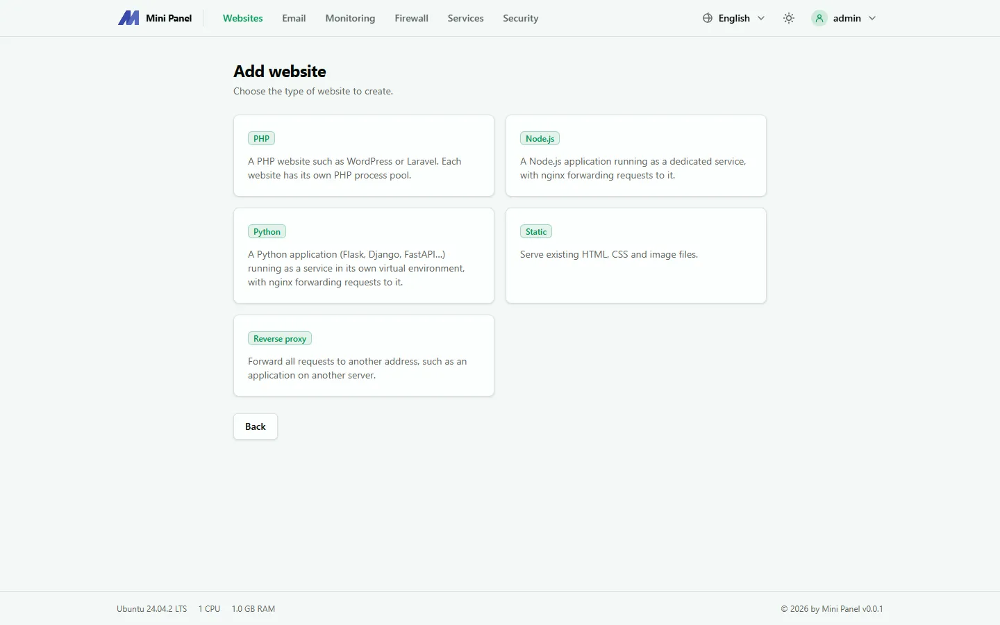

# Adding a website

The website page groups controls into tabs. **Overview** shows the current status and website settings. **Domain** contains domain and SSL controls, **SFTP** contains connection and account controls, and **Advanced** contains vHost configuration, acceleration and website deletion. The Email tab and Webmail setting appear only while the instance email service is enabled.

From the [Websites](index.md) page, scroll to the **Add website** form at the bottom, or go directly to `/sites/new`.

## Fields to fill in

* **Name**: lowercase letters, numbers and hyphens, up to 31 characters. This also becomes the system account name (SSH/SFTP) and the home directory name.
* **Type**: PHP, Node.js, Python, Static or Reverse proxy — see each type’s details in [Websites overview](index.md).
* **Domain**: one domain, e.g. `example.com`. Configure `www` and extra domains afterwards in the Overview tab.
* Type-specific fields:
  * **PHP**: PHP version (only versions already installed via [Services](../services.md) are listed).
  * **Node.js**: Node.js version, entry file (e.g. `server.js`).
  * **Python**: Python version, entry file or module (`-m myapp`).
  * **Reverse proxy**: upstream address (HTTP or HTTPS) to forward requests to.

## SSH/SFTP account

Each website gets its own system account. Leave the password blank to let the panel generate one randomly, or type your own (12–64 characters, no whitespace, quotes or backticks).

Caution

The password appears **only once**, on the result page right after creation. The panel never stores it anywhere — copy and save it immediately.

## After creating

Click **Create and apply**. The panel will:

1. Create the system account (if it doesn’t exist yet).
2. Create the home directory and web directory (`htdocs`, or the directory you specified).
3. Generate the Nginx configuration and apply it right away (`nginx -t` runs before reloading).
4. For PHP: provision a dedicated PHP-FPM pool for the website.
5. For Node.js/Python: create a dedicated systemd service that starts automatically with the server.

If something’s wrong (e.g. the name is already taken, or the PHP version isn’t installed), the panel reports the error right on the form and creates nothing.

## Next steps

* Open the new website to see its [Overview tab](overview-tab.md).
* For PHP websites, you can install WordPress or a PHP framework right from the Overview tab — see [WordPress](wordpress.md).
* Add [SSL](ssl.md) once the domain’s DNS points to this server.
