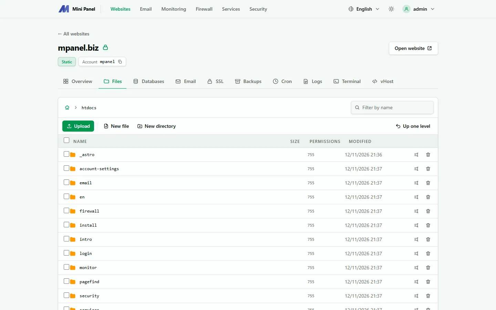
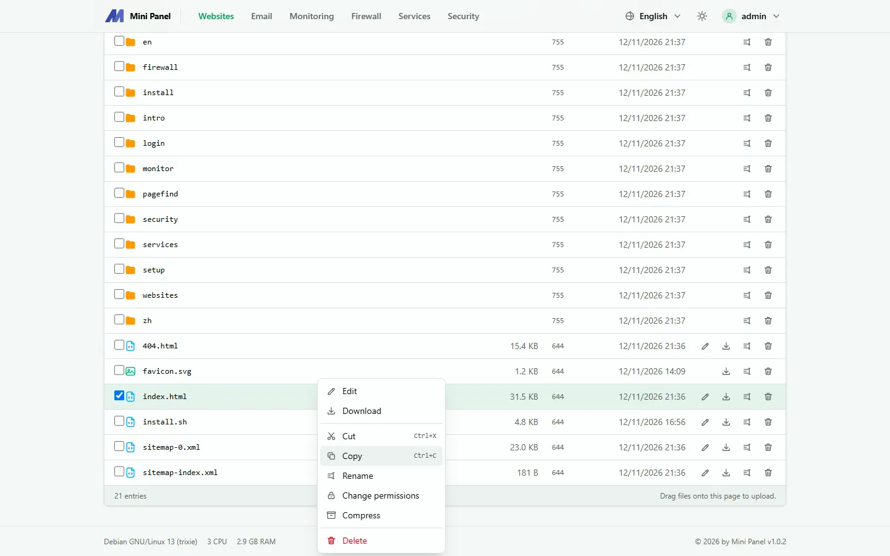
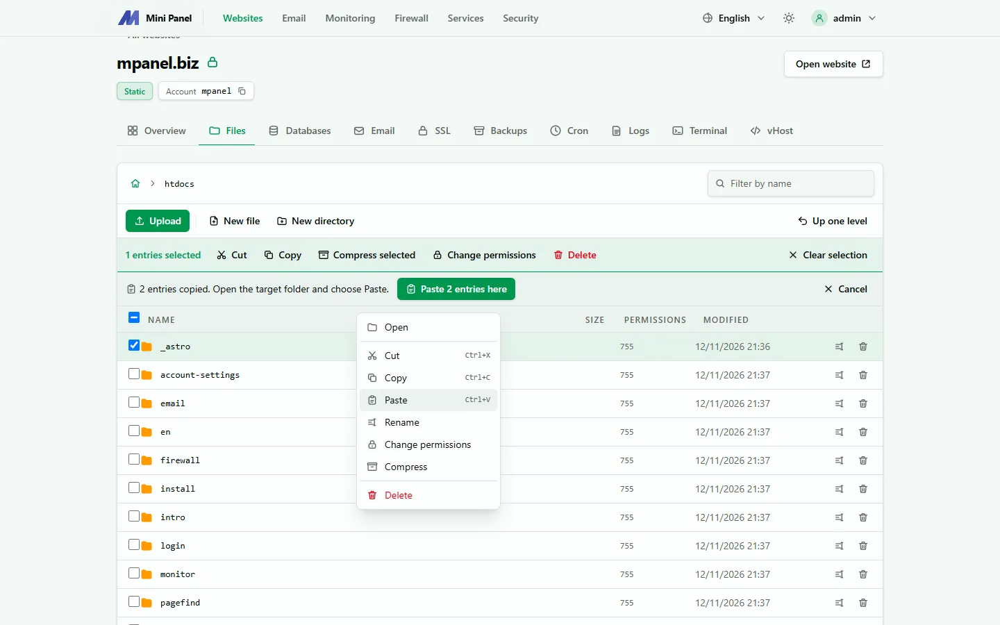

# Files

The **Files** tab is the website’s file manager. Every action runs as the website’s system account over SFTP, so it can only touch that website’s files and has exactly that account’s permissions.

## Requirements

The Files tab needs SSH/SFTP login enabled for the website, see [SSH/SFTP](ssh-sftp.md). If the panel says it cannot sign in as the website account, open the SSH/SFTP card and check the panel key.

## Browsing

* The path bar at the top shows the open directory. Click part of the path to go back to it, or click **Up one level**.
* Click a directory name to open it. Click a text file name to edit it.
* **Filter by name** hides entries that don’t match what you type.
* Click the **Name**, **Size** or **Modified** column header to sort.

Each directory shows up to 5,000 entries. If there are more, the panel says so; use the [Terminal](terminal.md) or SFTP to see them all.

## Creating and uploading

* **New file** and **New directory** create an entry in the open directory.
* **Upload** opens a file picker. You can also drag files onto the page. A progress bar shows while uploading. Tick **Overwrite existing files** to replace files with the same name.

Each upload can be up to 1 GB.

## Selecting several entries

Tick the box at the left of each row, or the box in the table header to select all. When entries are selected, a toolbar appears with **Cut**, **Copy**, **Compress selected**, **Change permissions** and **Delete**. Click **Clear selection** to cancel.

## Right-click menu

Right-click an entry to open its menu. The menu depends on the entry: files have **Download** (text files also have **Edit**, ZIP files also have **Extract**), directories have **Open**. Right-click an empty area for **Upload**, **New file**, **New directory**, **Refresh** and **Paste**.

## Cut, copy and paste

1. Select one or more entries, then choose **Cut** or **Copy** (from the toolbar, the right-click menu or a shortcut).
2. Open the target directory. A bar above the table shows how many entries are waiting to be pasted.
3. Click **Paste N entries here**, or right-click a directory and choose **Paste** to paste into it.

**Cut** moves the entries, **Copy** makes copies. Click **Cancel** on the paste bar to drop them. The waiting list lives only in the open browser tab and works only within the same website.

A directory cannot be pasted into itself or into one of its subdirectories. If an error happens partway, the panel reports how many files and directories it processed before the error.

## Editing files

Choose **Edit** to open the file in an editor with syntax highlighting. Press **Ctrl+S** to save. The panel only opens text files under 2 MB.

If the file was changed elsewhere after you opened it, the panel does not overwrite it straight away and tells you. Your edits stay on the page; save again to overwrite.

## Compressing and extracting

* **Compress** (or **Compress selected**) creates a ZIP file in the open directory. You choose its name.
* **Extract** unpacks a ZIP file into the open directory. Tick **Overwrite when extracting** to replace existing files.

The panel skips links and special files inside a ZIP, and refuses ZIP files that would write outside the target directory.

## Changing permissions

**Change permissions** opens a dialog with nine boxes (read, write and execute permissions for the owner, group and others) or an octal field such as `644`. For directories you can apply the change to their contents recursively, choosing files only, directories only or both. Common values: files `644`, directories `755`.

If the website account is not in a directory’s group, the system may remove its setgid bit when permissions change. The panel tells you when this happens.

## Keyboard shortcuts

Shortcuts work only when you are not typing in a field.

| Key | Action |
| --- | --- |
| **F2** | Rename the selected entry |
| **Delete** | Delete the selected entries |
| **Ctrl+X** | Cut |
| **Ctrl+C** | Copy (when no text is selected on the page) |
| **Ctrl+V** | Paste into the open directory |
| **Esc** | Close the menu, clear the selection |

Caution

Deleting cannot be undone. A deleted directory goes with everything in it. Take a [backup](backups.md) before deleting anything important.
