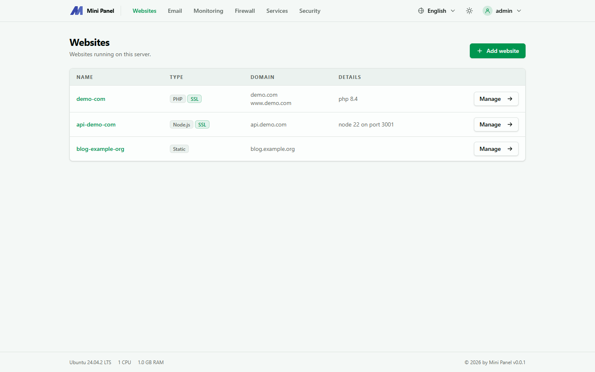

# Websites overview

The **Websites** page is the panel’s main page — it lists every website currently running on the server.

## Information shown for each website

* **Name**: the website’s system name (used as the SSH/SFTP account name and home directory name).
* **Type**: PHP, Node.js, Python, Static or Reverse proxy.
* **Domain**: the primary domain; extra domains collapse into “+N other domains”.
* **Details**: the runtime version (PHP 8.4, Node 22…) or the upstream address (for reverse proxy).
* **SSL**: whether a TLS certificate is installed.

## Website types

| Type | Used for | Default document root |
| --- | --- | --- |
| **PHP** | WordPress, Laravel, custom PHP code | `htdocs` (or `public` when using a PHP framework) |
| **Node.js** | Long-running Node apps (Express, Next.js…) | the directory chosen at creation |
| **Python** | Flask, Django, FastAPI, running in their own virtualenv | the directory chosen at creation |
| **Static** | Plain HTML/CSS/JS, no server-side processing | `htdocs` |
| **Reverse proxy** | Forwards requests to another address (an app running on a different host/port) | not applicable |

Each type has different settings tabs once you open a website’s detail page — see [Adding a website](adding-a-website.md) and [Overview tab](overview-tab.md).

## What you can do from here

* [Add a new website](adding-a-website.md)
* Click a website’s name to open its detail page, with tabs: Overview, Databases, Backups, and more. The SSH/SFTP settings are in Overview.
* **Apply**: reload the website’s Nginx configuration (useful after a manual edit, or if the running configuration seems out of sync with saved settings).
* **Remove**: delete the website from the server (with a confirmation step before it happens).
